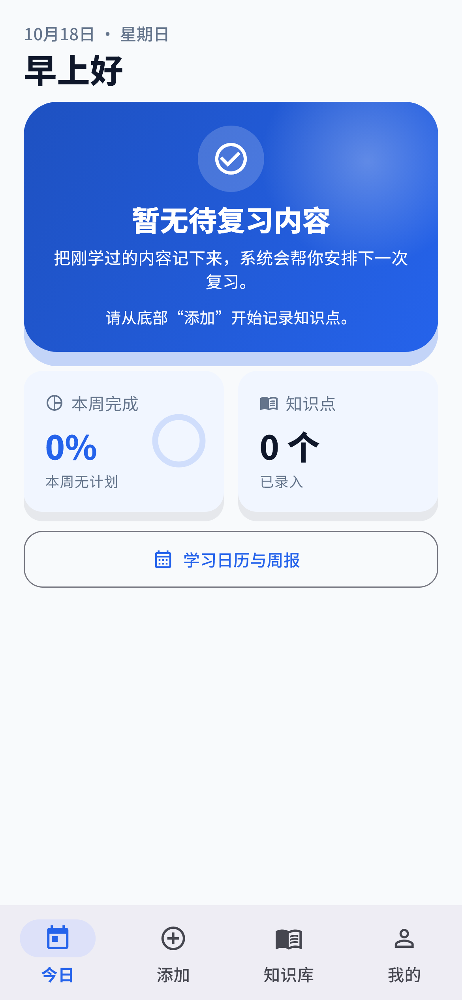

# 慧学习 | Hui Xue Xi

慧学习是一款本地优先的 Android 间隔复习应用。记录知识点后，应用按复习计划提醒回顾，并支持为知识点附加本机 PDF 和图片资料，在应用内阅读或查看。

Hui Xue Xi is a local-first spaced-repetition app for Android. Record study items, review them on schedule, and attach local PDF and image materials for in-app reading and viewing.

*首页 UI 渲染预览（固定测试日期和空数据；不是实机截图）。*

## 下载与安装 | Download and install

- 最新版本 / Latest release: [v1.37](https://github.com/heyPython2026/huixuexi/releases/latest)
- 平台 / Platform: Android, `arm64-v8a` (64-bit ARM)
- 最低 Android API / Minimum Android API: 24
- 应用包名 / Package ID: `com.memorycurve.memory_curve`
- 版本 / Version: `1.0.37` (build `37`)

从最新 Release 下载标注为“慧学习_v1.37_android_arm64_release.apk”的文件。下载文件名为 `HuiXueXi_v1.37_android_arm64_release.apk`，然后按 Android 系统提示安装。系统可能要求先允许浏览器或文件管理器安装应用。

Download the asset labeled `慧学习_v1.37_android_arm64_release.apk` from the latest Release. Its downloaded filename is `HuiXueXi_v1.37_android_arm64_release.apk`; then follow Android's installation prompts.

## 功能 | Features

- 按艾宾浩斯间隔安排复习，并依据掌握反馈调整后续任务。
- 管理学科、知识点、学习内容和复习历史。
- 为知识点附加多份本地 PDF 和图片，并在详情及复习时查看。
- 使用 JSON 文本备份和恢复知识点记录。
- Spaced reviews based on the Ebbinghaus schedule and review feedback.
- Manage subjects, study items, learning notes, and review history.
- Attach multiple local PDFs and images to a study item and view them in the detail and review flows.
- Export and restore study records using JSON text.

## 数据与已知限制 | Data and known limits

- 学习记录、PDF 和图片副本只保存在本机；没有账号和云同步。
- JSON 备份不包含 PDF、图片文件、阅读进度或本机附件路径。卸载应用或清除应用数据后，本机资料和附件需要重新添加。
- 目前只发布 Android `arm64-v8a` APK；未提供 iOS、桌面或其他 Android 架构版本。
- 此版本 APK 使用 Android Debug 签名证书；它不是 Google Play/生产签名，不能保证可覆盖由其他签名证书签署的安装包。
- v1.37 APK 的包名、ARM64 ABI、签名证书和 SHA-256 已核对；未连接实体设备，安装与启动尚未实机验证。
- Study records and PDF and image copies stay on this device; there are no accounts or cloud sync.
- JSON backup excludes PDF and image files, reading progress, and local attachment paths. Uninstalling or clearing app data removes local records and attachments.
- Only an Android `arm64-v8a` APK is currently published; iOS, desktop, and other Android architectures are not provided.
- This APK is signed with an Android Debug certificate, not a Google Play/production key. Upgrade compatibility with packages signed by another key is not guaranteed.
- The v1.37 APK package ID, ARM64 ABI, signing certificate, and SHA-256 were checked. No physical-device install/startup verification was performed.

## 联系与许可 | Contact and licensing

联系邮箱 / Contact: [635873431@qq.com](mailto:635873431@qq.com)

本项目未授予开源许可证。第三方组件的许可说明见 [`THIRD_PARTY_NOTICES.txt`](THIRD_PARTY_NOTICES.txt) 和 [`third_party/pdfium/`](third_party/pdfium/)。This project has no open-source license; see the third-party component notices linked above.

本仓库只包含可下载的 APK 和用户说明，不包含应用源码或构建输入。 / This repository contains the downloadable APK and user-facing materials only; application source and build inputs are not published.
